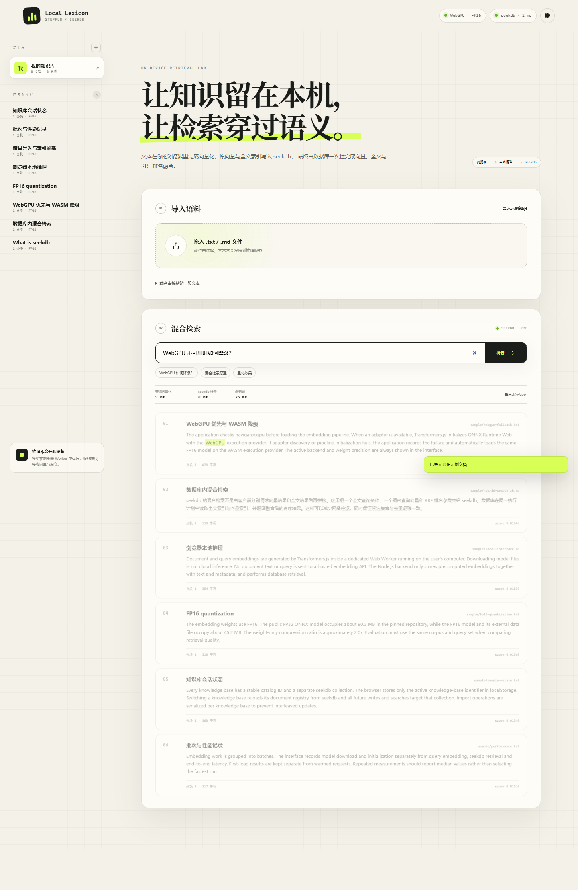

# Local Lexicon

**StepFun 生态赛题：端侧 AI 推理性能优化与 seekdb 混合检索**

Local Lexicon 是一个可直接运行的迷你知识库应用：

- 文档和查询 embedding 均在浏览器 Web Worker 内完成，无云端推理 API。
- 默认优先使用 WebGPU + FP16；WebGPU 不可用或初始化失败时自动降级到 WASM + FP16。
- 原文、384 维向量和元数据写入 seekdb。
- 向量与全文混合检索由单次 `seekdb` `hybridSearch()` 调用完成，并在数据库内使用 RRF 融合。
- 支持增量导入、重复内容更新、索引刷新可见性屏障、知识库切换和文档删除。



## 已验证结果

测试日期：2026-11-04；浏览器：Microsoft Edge 156.0.4314.58；seekdb：1.4.0.0。

| 配置 | 8 文档向量化中位数 | 向量化吞吐 | 查询向量化中位数 | seekdb 检索中位数 | 端到端中位数 | Recall@1/3/5 |
| --- | ---: | ---: | ---: | ---: | ---: | ---: |
| FP32 + WebGPU 基线 | 89.03 ms | 89.86 docs/s | 7.04 ms | — | — | 1.000 / 1.000 / 1.000 |
| FP16 + WebGPU | 83.83 ms | 95.43 docs/s | 7.27 ms | 4.58 ms | 25.15 ms | 1.000 / 1.000 / 1.000 |
| FP16 + WASM | 604.28 ms | 13.24 docs/s | 9.84 ms | 4.54 ms | 26.72 ms | 1.000 / 1.000 / 1.000 |

说明：

- 文档向量化取 3 次重复的中位数；查询、seekdb 检索和端到端延迟取 5 次查询的中位数。
- 模型权重体积从 90,318,300 bytes（FP32）降至 45,184,187 bytes（FP16），压缩比 `1.9989`，减少约 49.97%。
- 评测集为 8 篇示例文档、8 条中英文查询。FP16 相对 FP32 的 Recall@1/3/5、MRR@5、nDCG@5 变化均为 0。
- “端到端”从提交查询开始，包含浏览器查询向量化、HTTP、seekdb 混合检索和结果 DOM 渲染。
- seekdb 检索耗时包含 SDK 调用与数据库执行，不包含查询向量化。

完整原始记录位于 [`results/quality`](results/quality) 和 [`results/evidence`](results/evidence)；方法和限制见 [`docs/benchmark-method.md`](docs/benchmark-method.md)。

## 快速启动

### 1. 环境

- Node.js 22.12 或更高版本。
- Chrome / Edge 最新版。
- seekdb 1.4.0 或更高版本，Windows/Linux 均可；本验证环境为 Windows x64。

### 2. 安装

```powershell
cd stepfun
npm ci
```

仓库内 `.npmrc` 固定了 `legacy-peer-deps=true`，用于规避 `seekdb` 可选 peer 依赖元数据中的 npm `workspace:*` 解析问题。应用本身不依赖该 peer 包。

### 3. 配置 seekdb

启动 seekdb 服务后，将 `.env.example` 复制为 `.env` 并填写连接信息：

```dotenv
SEEKDB_HOST=127.0.0.1
SEEKDB_PORT=2881
SEEKDB_USER=root
SEEKDB_PASSWORD=your-local-password
SEEKDB_DATABASE=competition
```

创建数据库：

```powershell
npm run init-db
```

应用首次启动时会在该数据库中创建：

- `stepfun_kb_catalog`：知识库目录和稳定集合映射。
- `stepfun_kb_documents`：文档登记、内容哈希、分块数和模型配置。
- `stepfun_kb_<id>`：每个知识库独立的 seekdb collection。

### 4. 开发运行

```powershell
npm run dev
```

打开 `http://127.0.0.1:3000`。

### 5. 生产运行

```powershell
npm run build
npm run start:win
```

Linux/macOS 使用 `npm start`。

## 使用流程

1. 首次打开时应用自动创建一个知识库。
2. 点击“装入示例知识”，或拖入 `.txt` / `.md` 文件，或直接粘贴文本。
3. 浏览器 Worker 下载并缓存固定 revision 的 ONNX 模型，在本地完成分块向量化。
4. 服务端将原文、向量和元数据 upsert 到 seekdb，调用 `refresh_index()`，并轮询确认新分块可见。
5. 输入自然语言问题；浏览器本地生成查询向量，服务端执行一次数据库混合检索并返回 RRF 排序结果。
6. 顶栏始终显示当前推理后端（WebGPU / WASM）和 seekdb 连接状态。

## 模型与量化

- 模型：[`onnx-community/all-MiniLM-L6-v2-ONNX`](https://huggingface.co/onnx-community/all-MiniLM-L6-v2-ONNX)
- 固定 revision：`aff7a1dc4e8a1ea593e6ea21e95c22ef0a25966f`
- 许可证：Apache-2.0
- 向量维度：384
- 默认精度：FP16
- 推理 API：Transformers.js 4.3.2，ONNX Runtime Web

模型静态文件下载和本地缓存不等同于云端推理。所有 tokenize、attention 和 embedding 计算都发生在浏览器 Worker 内。

## seekdb 数据与检索

每个 collection 使用以下 Schema：

```text
FulltextIndexConfig("ik", { ik_mode: "smart" })
VectorIndexConfig(hnsw, dimension=384, distance=cosine, embeddingFunction=null)
```

应用侧已经生成 embedding，因此数据库不重复调用云端模型。混合检索入口：

```js
collection.hybridSearch({
  query: { whereDocument: { $contains: sanitizedQuery } },
  knn: { queryEmbeddings: [queryEmbedding] },
  rank: { rrf: { rankWindowSize: candidateSize, rankConstant: 60 } },
  nResults: topK,
});
```

返回结果是 seekdb 单次 `DBMS_HYBRID_SEARCH` 执行后的融合结果，客户端没有分别拉取两份候选集再自行拼合。

### 增量与刷新

- 文档 ID 为原文 SHA-256；分块 ID 为 `<sha256>:<index>`。
- 重复导入同一内容会更新已有分块，并清理变短后遗留的尾部分块。
- 每次写入后调用 `collection.refresh_index()`，再用带 `documentId` 过滤的向量查询确认新分块可见；验证成功后才向 UI 报告导入完成。
- 每个知识库使用独立 collection；浏览器仅在 `localStorage` 保存当前知识库 ID。

## 测试

```powershell
# 单元测试
npm test

# 前端生产构建
npm run build

# 真实 seekdb 集成测试（会创建并清理临时知识库）
$env:STEPFUN_INTEGRATION = "1"
npm run test:integration

# 独立无头 Edge：导入、刷新、混合检索、知识库隔离
npm run test:browser

# 同一套浏览器测试，但移除 WebGPU 适配器，验证自动 WASM 降级
$env:STEPFUN_DISABLE_WEBGPU = "1"
npm run test:browser
```

## 量化质量回归

```powershell
npm run benchmark:quality

$env:QUALITY_BACKEND = "wasm"
$env:QUALITY_DTYPES = "fp16"
npm run benchmark:quality
```

质量评测页为 `http://127.0.0.1:3000/benchmark.html?dtype=fp16&backend=auto&batch=8`。它只用于离线比较 FP32/FP16 embedding 排序，不参与主应用的存储或检索。

## 目录

```text
stepfun/
  server/                   Express API、seekdb 数据层、刷新与检索
  web/src/embedding-worker 浏览器本地 ONNX 推理
  web/src/main.js          导入、知识库状态和检索 UI
  public/                  示例语料与固定评测问题
  benchmark.html           量化前后质量评测页
  scripts/                 初始化、健康检查、浏览器与质量基准
  tests/                   单元测试和 seekdb 集成测试
  docs/                    一页技术说明与评测方法
  results/                 实际运行原始 JSON 与截图
```

更完整的技术说明见 [`docs/technical-report.md`](docs/technical-report.md)，可直接提交的单页版本为 [`output/pdf/technical-report.pdf`](output/pdf/technical-report.pdf)。
