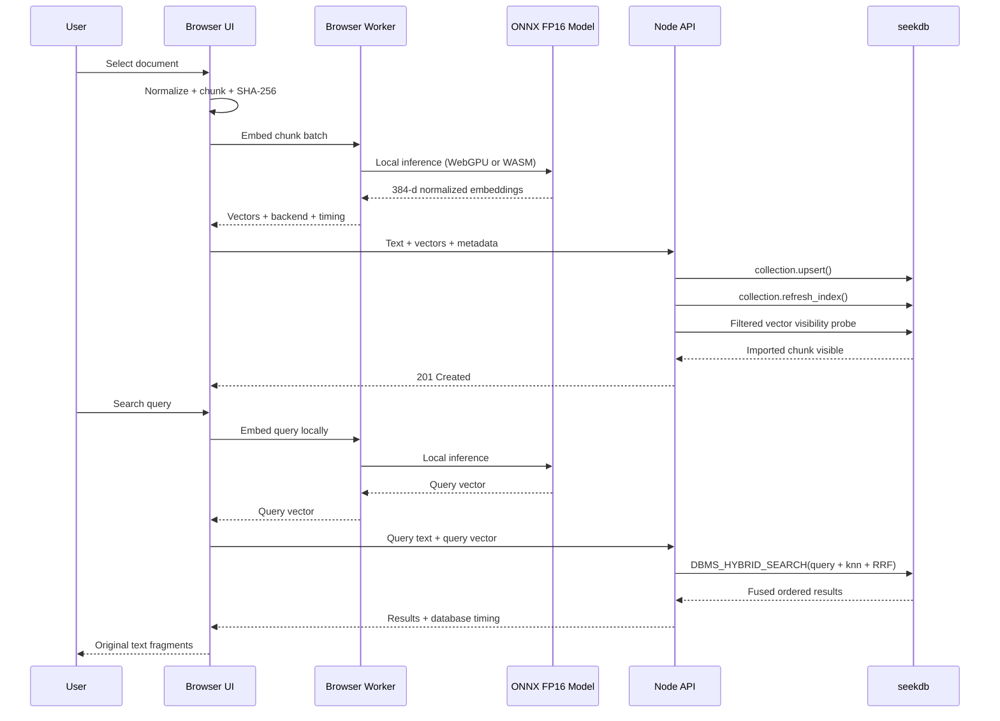

# Architecture

## Trust boundaries

- Browser: owns document text before upload and all embedding computation.
- Node API: has database credentials; never performs embedding inference.
- seekdb: owns collection tables, fulltext index, HNSW index, and hybrid rank
  execution.

The Node process listens on `127.0.0.1` by default. It is a local companion
service, not a cloud proxy.
